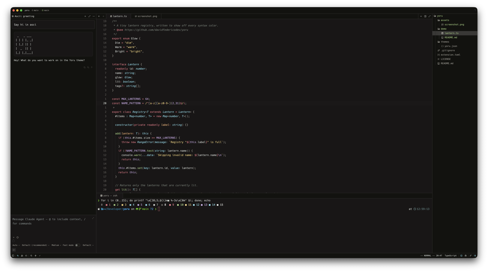

# Yoru

*Yoru* (夜) means "night" in Japanese.

Yoru is a calm, low-contrast dark theme for [Zed](https://zed.dev). Its surfaces use the warm ink blacks of Kanagawa Dragon. Its syntax colors are soft and inspired by Monokai.

*Shown with [`demo/lantern.ts`](demo/lantern.ts) and Hack Nerd Font.*

## Variants

| Theme | Appearance |
|---|---|
| Yoru Dark | dark |

## Installation

**From the Zed extension registry** (once published): open `zed: extensions`, search for **Yoru**, and click Install.

**From source:**

1. Clone this repository.
2. In Zed, run `zed: install dev extension` and select the cloned folder.
3. Open `theme selector: toggle` and choose **Yoru Dark**.

## Palette

| Role | Color |
|---|---|
| Editor background | `#181616` |
| Panels / bars | `#12120f` |
| Surfaces | `#1D1C19` `#282727` `#393836` |
| Foreground | `#c5c9c5` |
| Muted text | `#9e9b93` |
| Comments | `#737c73` |
| Keywords, operators, tags | `#e07080` |
| Functions | `#98c379` |
| Strings | `#e8c878` |
| Types, constructors | `#7dcfdc` |
| Numbers, constants | `#c0a0d8` |
| Parameters, warnings | `#e8a870` |

## Credits

Yoru builds on the work of these themes:

- **[Kanagawa](https://github.com/rebelot/kanagawa.nvim)** by Tommaso Laurenzi (MIT). The UI surfaces, foreground, muted grays, and comment tones come from the *Dragon* variant's palette.
- **[Monokai](https://monokai.nl)** by Wimer Hazenberg. Inspired the syntax scheme: pink keywords, green functions, yellow strings, and purple constants.
- **[One Dark](https://github.com/atom/one-dark-syntax)** by the Atom team / GitHub (MIT). The function and success green `#98c379` comes from One Dark.

## License

[MIT](LICENSE) © 2026 David Federico
